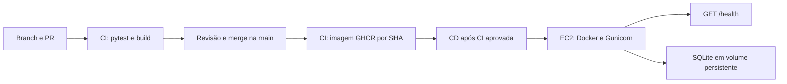

# Meu projeto de Computação em Nuvem: Cloud Tasks API

Este é meu diretório de trabalho para entregar uma API na AWS com GitHub Actions, Docker e GitHub Container Registry (GHCR), a partir da base fornecida pelo professor.

**Integrante:** Rafael Bitu Castro de Abreu (RA22301190), projeto individual.
**Repositório GitHub:** [bingxyi/cloud-pipeline-aws](https://github.com/bingxyi/cloud-pipeline-aws).
**Responsabilidade individual:** implementação da API e testes, contêiner e validação local, preparação do pipeline e da infraestrutura, relatório e entrega. A EC2 foi criada segundo o host; bootstrap e Docker foram validados por SSH; deploy, publicacao e CI remota permanecem pendentes.
**Situação:** pytest (9 testes), build Docker, smoke test local e persistência após recriar o contêiner foram aprovados pelo harness no host. EC2 `i-0c6f23086bc98c45e` (`54.198.190.67`, SG `sg-09352ffbaa35709b2`) foi criada; `-Status` autenticou a chave pública do host e gerou `known_hosts`. SSH e Docker foram validados; deploy, CI remota, GHCR e publicacao do codigo ainda estao pendentes.
**GitHub:** commits e publicacao automatizados autorizados; manter o fluxo de branch feature e PR, sem Co-Authored-By.

**Registro desta execucao:** [relatorio e pendencias verificadas](docs/RELATORIO.md).
**Proximas etapas:** [publicacao automatizada ao GitHub e fluxo de PR](docs/PROXIMOS_PASSOS.md).
Harness local preparado: `bash run-harness.sh` (requer Python com dependências e Docker Compose).
Nenhum deploy AWS foi realizado. O volume `cloud-tasks-smoke-535_cloud-tasks-data` foi mantido para inspeção dos dados; não o remova durante limpeza automática.

## Escopo do trabalho

O objetivo central é demonstrar a esteira de entrega na nuvem. Não preciso reescrever a API nem criar uma interface gráfica. Preciso entregar:

1. Repositório próprio com integrantes e instruções de uso.
2. EC2 Linux com Docker, Security Group documentado e HTTP acessível.
3. CI nos PRs com pytest e build Docker, sem publicar imagem nem disparar deploy.
4. Publicação no GHCR somente após push na main, com tag correspondente ao SHA.
5. CD após CI aprovada, implantando a imagem daquele commit e validando `/health`.
6. Secrets protegidos e SSH restrito, conforme orientação docente.
7. DELETE `/tasks/<id>` com 204/404 e dois testes, mais uma melhoria com teste.
8. Branch `feature/...`, PR revisado, CI aprovada e merge na main.
9. Prova de persistência após recriar o contêiner.
10. Relatório, evidências, apresentação e encerramento dos recursos.



Referências locais: [enunciado completo](ENUNCIADO_ALUNOS.md) e [guia de configuração](docs/CONFIGURACAO.md). O enunciado originalmente prevê 14 dias; a janela de duas horas exige pré-requisitos prontos.

## Inventário completo da base

Todos os 18 arquivos foram inspecionados. Este diretório contém uma cópia da base com README próprio; o diretório original permanece intacto.

| Arquivo | Conteúdo e ação necessária |
|---|---|
| `app/main.py` | Flask/SQLite; GET `/`, `/health`, `/version` e `/tasks`, POST/PATCH/DELETE `/tasks/<id>`. DELETE responde 204 sem corpo após excluir e 404 JSON para ID inexistente; versão informa `cloud-tasks-api` 1.1.0. |
| `app/wsgi.py` | Entrada do Gunicorn; validar em contêiner. |
| `app/__init__.py` | Inicialização do pacote; sem alteração planejada. |
| `tests/test_api.py` | Nove testes para saúde, criação/listagem, validação, PATCH, DELETE 204/404, contrato de `/version` e persistência em banco após recriação da aplicação. Os nove passaram localmente. |
| `tests/test_runner_ssh_access.sh` | Testes simulados para regra temporária do runner; chamadas AWS CLI e consulta de IP são mockadas, sem chamadas AWS reais. Incluído no harness e na CI. |
| `.github/workflows/ci.yml` | Python 3.12, pytest, teste simulado do acesso SSH e build nos PRs; publicação GHCR na main. Execução remota pendente. |
| `.github/workflows/cd.yml` | CI aprovada via workflow_run, checkout do SHA, SSH e HTTP. Configurar secrets e rede. |
| `scripts/provision-aws.ps1` | Criou a EC2 Ubuntu 24.04 `t3.micro` reportada abaixo; chave e estado fora do repositório. `-Status` autenticou a chave pública de host. |
| `scripts/setup-ec2-ubuntu.sh` | Instala Docker/curl e adiciona usuário ao grupo Docker. |
| `scripts/deploy.sh` | Pull, volume, substituição do contêiner e espera por saúde. Demonstrar funcionamento e persistência. |
| `Dockerfile` | Python 3.12 slim, usuário sem root, Gunicorn com dois workers, porta 8000. Validar build e permissões do volume. |
| `compose.yaml` | Porta local 8080 e volume cloud-tasks-data em /data. Validar se houver Docker local. |
| `requirements.txt` | Flask >=3.1,<4 e Gunicorn >=23,<24. Instalar; não há fixação exata de versões. |
| `requirements-dev.txt` | Dependências de execução e pytest >=8,<10. Instalar para testes. |
| `pytest.ini` | Descoberta dos testes em tests/. |
| `.gitignore` | Exclui caches, ambiente virtual, .env, bancos, .pem e .key. Conferir antes do commit. |
| `.dockerignore` | Exclui caches, Git e alguns dados locais. Regras para .pem, .key, .aws e .codex adicionadas. |
| `README.md` original | Apresentação da base e desafio; substituído por este documento próprio. |
| `ENUNCIADO_ALUNOS.md` | Requisitos, avaliação, entrega e regras. |
| `docs/CONFIGURACAO.md` | Procedimento AWS/GitHub/GHCR, rede, diagnóstico e encerramento. |

### Diagnóstico técnico

- A criação exige título não vazio com até 120 caracteres; o PATCH exige `done` booleano.
- O banco é configurável por DB_PATH. No contêiner fica em `/data/tasks.db`; o deploy usa o volume `cloud-tasks-data`.
- O harness local comprovou a persistência ao recriar o contêiner com o volume preservado; isso não comprova persistência após deploy em EC2.
- O pacote GHCR precisa ser público para o pull anônimo previsto na base.
- O CD usa runner hospedado `ubuntu-latest`, sem configurar liberação temporária do Security Group ou acesso por rede permitida. Este é o principal bloqueio externo.
- Não há controle de concorrência de deploys nem rollback automático; a substituição do contêiner pode gerar indisponibilidade.
- Não há infraestrutura como código, TLS, autenticação da API, balanceador ou alta disponibilidade; não incluir esses extras no prazo proposto.
- Inventário somente leitura recente da conta alvo em `us-east-1`: sem instâncias nos estados consultados; somente o security group default foi listado. Custos e runs remotos ainda não foram verificados; o URL do repositório está identificado acima, mas o upload não foi feito.

## Inventário do que preciso para executar

### Ferramentas

Diagnóstico do ambiente de trabalho nesta sessão (Python instalado localmente, sem configuração do sistema):

| Item | Situação | Necessidade |
|---|---|---|
| Git | Disponível: 2.55.0.windows.3 | Histórico próprio, branches e commits. |
| Python | Harness no host: 9 testes aprovados em 0.73s. | Verificação local concluída. |
| Docker | Docker Desktop ativo; build da imagem Ubuntu/Python 3.12 e harness local concluídos, incluindo health, version, DELETE e persistência após recriar contêiner. | Volume nomeado `cloud-tasks-smoke-535_cloud-tasks-data` mantido. Containers e rede do harness removidos. |
| GitHub | Publicacao automatizada autorizada pelo usuario | Publicação, CI e configuração remotas ainda não verificadas. |
| AWS CLI | Inventário inicial somente leitura encontrou apenas o security group default. Depois, host criou `i-0c6f23086bc98c45e` em `us-east-1`, IP `54.198.190.67`, grupo `sg-09352ffbaa35709b2`; `-Status` validou tag e gerou `known_hosts` a partir do console autenticado. | Cloud-init done e Docker 29.1.3 validados pelo usuario via SSH; aplicacao nao implantada. |
| SSH e curl.exe | Disponíveis | Administração e validação HTTP. |
| Rede | Download local do Python e dependências concluído | Acesso ao GitHub, Actions e GHCR não verificado. |

### Contas, permissões e informações

| Item necessário | Dados ou capacidade requerida |
|---|---|
| Identificação | Nome, matrícula, integrantes e divisão de tarefas. |
| GitHub | Conta acessível, proprietário e nome do novo repositório; permissão para criar repo, publicar branches, abrir/revisar/mesclar PR e configurar Actions. |
| GHCR | Permissão packages: write no job; capacidade de tornar o pacote público conforme o modelo da base. |
| AWS | Conta ativa, região, orçamento máximo e permissão para EC2, EBS, rede, Security Group e chave. |
| Rede | VPC/sub-rede com rota à internet e IP público ou configuração equivalente já disponível. |
| Instância | Ubuntu Server 24.04 LTS x86_64, tipo e disco definidos conforme orçamento e limites da conta. |
| Administração | Usuário ubuntu, chave SSH fora do repositório, IP administrativo confiável permitido e fingerprint obtida por canal confiável. |
| Runner | Caminho seguro entre runner e EC2 conforme orientação docente; definir nos primeiros dez minutos. |
| HTTP | Porta 80 livre no host e acessível aos responsáveis pela validação. |
| Entrega | Acesso ao Moodle, prazo da apresentação e definição de vídeo ou demonstração. |
| Custos/limpeza | Registro de todos os recursos criados e momento permitido para encerrá-los após demonstrar. |

Não preciso receber senhas, tokens ou chaves privadas no chat ou neste README. Configurar os acessos no ambiente ou diretamente nos serviços.

### Configuração do Actions e da aplicação

| Nome | Local/tipo | Valor esperado |
|---|---|---|
| EC2_HOST | Secret Actions | IP/DNS público sem protocolo. |
| EC2_SSH_KEY | Secret Actions | Chave privada autorizada na EC2. |
| EC2_KNOWN_HOSTS | Secret Actions | Chave SSH do host coletada pelo provisionador via console AWS autenticado; não usar `ssh-keyscan` sem validação. |
| EC2_USER | Variable Actions | ubuntu na AMI indicada. |
| EC2_SECURITY_GROUP_ID | Variable Actions | Grupo da instância para abertura temporária de SSH ao runner. |
| AWS_ACCESS_KEY_ID, AWS_SECRET_ACCESS_KEY, AWS_SESSION_TOKEN | Secrets Actions | Credenciais temporárias do laboratório, exigidas para abrir/remover a regra SSH temporária; renovar manualmente quando expirarem. |
| production | Environment GitHub | Ambiente referenciado no CD; configurar proteção se disponível. |
| GITHUB_TOKEN | Fornecido pelo Actions | Já usado pela CI; conferir permissão de publicação. |
| DB_PATH | Ambiente da aplicação | /data/tasks.db no contêiner e caminho gravável no Windows. |

A CD pode abrir SSH ao IP /32 do runner temporariamente, usando a variável e as credenciais Actions listadas acima, e tenta revogar exatamente a regra criada mesmo após falha do deploy. Cancelamento forçado ou expiração das credenciais podem impedir a revogação; confira o Security Group após cada execução e remova regras residuais. Não abra SSH para `0.0.0.0/0`. Uma alternativa é runner auto-hospedado em rede autorizada, conforme orientação docente.

## Decisões propostas para caber em duas horas

1. DELETE está implementado com 204 e corpo vazio ao excluir, e 404 JSON para ID inexistente. Os testes também conferem a ausência na listagem.
2. GET `/version` está implementado como melhoria, com contrato testado para serviço `cloud-tasks-api` e versão `1.1.0`. O SHA não é exposto pela aplicação.
3. Manter Flask/SQLite, Docker, GHCR e EC2. Sem frontend, Kubernetes, RDS, domínio ou TLS nesta janela.
4. Usar rede segura já disponível ou indicada pelo professor. Se faltar Python/Docker local, usar Actions e EC2 para validar, condicionado aos acessos prontos.

## Plano com teto de 120 minutos

Esta tabela descreve trabalho futuro, não etapas já executadas.

| Minutos | Atividade | Evidência esperada |
|---|---|---|
| 00–10 | Confirmar contas, região, orçamento, identidade e rede; criar repo e commit da base | Repositório próprio e estratégia de deploy definida. |
| 10–30 | Criar feature branch, implementar DELETE e /version, adicionar e executar testes | Pelo menos oito testes aprovados. |
| 30–45 | Provisionar EC2, configurar SG, instalar Docker e reconectar | Docker funcional e SSH restrito. |
| 45–60 | Configurar secrets/environment/rede, abrir PR e acompanhar CI | Testes e build aprovados no PR sem publicação/deploy. |
| 60–80 | Registrar revisão, merge, publicação, visibilidade pública do pacote e CD | Imagem por SHA e CD aprovado. |
| 80–95 | Validar API externa e persistência após recriar contêiner | Mesmo ID e conteúdo antes/depois. |
| 95–110 | Consolidar README, relatório, links, custos e apresentação | Entrega com evidências reais. |
| 110–120 | Margem de correção; limpar recursos após demonstração se o momento permitir | Limpeza comprovada ou pendência de encerramento explicitamente registrada. |

Na primeira publicação, o CD pode falhar até o pacote se tornar público. Ajustar a visibilidade e reexecutar o CD dentro da janela prevista.

Se autenticação, provisionamento ou rede segura não estiverem resolvidos no começo, não há garantia responsável de entrega integral em 120 minutos. Código, testes e documentação podem avançar, mas um deploy pendente não satisfaz o trabalho completo. Filas de Actions, downloads e disponibilidade AWS também afetam o prazo.

## Executar após preparar o ambiente

### Windows com Python 3.12

```powershell
py -3.12 -m venv .venv
.\.venv\Scripts\python.exe -m pip install -r requirements-dev.txt
$env:DB_PATH = Join-Path $PWD 'tasks-local.db'
.\.venv\Scripts\python.exe -m pytest -q
.\.venv\Scripts\python.exe -m flask --app app.main run --port 5000
```

Use o comando para executar os testes localmente. A última execução do harness no host aprovou os nove testes. Como alternativa, crie um venv com `uv venv --python 3.12 .venv` e instale dependências usando `uv pip install --python .venv/Scripts/python.exe -r requirements-dev.txt`. O diretório `.venv` é ignorado pelo Git. O servidor Flask é usado para desenvolvimento; o contêiner usa Gunicorn.

### Docker Compose

```bash
docker compose up --build -d
curl --fail http://localhost:8080/health
```

No host Windows, para executar o harness local e a inspeção AWS somente leitura:

```powershell
powershell.exe -NoProfile -ExecutionPolicy Bypass -File .\scripts\validate-host.ps1
```

O harness concluiu build, smoke test e persistência local no host. O volume persistente criado pelo teste foi mantido para inspeção; não remova o volume como parte de limpeza.

### Demonstrar persistência na EC2

1. Criar tarefa fictícia por POST /tasks e registrar ID e título.
2. Consultar GET /tasks e salvar a resposta anterior à recriação.
3. Executar novamente scripts/deploy.sh com a mesma imagem por SHA, mantendo cloud-tasks-data.
4. Consultar /health e /tasks e registrar o mesmo ID e conteúdo.
5. Guardar evidências com dados sensíveis removidos. Reiniciar apenas o processo não comprova recriação do contêiner.

## Checklist de entrega

- [x] Integrante: Rafael Bitu Castro de Abreu, RA22301190; projeto individual.
- [ ] Publicacao automatizada para [bingxyi/cloud-pipeline-aws](https://github.com/bingxyi/cloud-pipeline-aws) e acesso do professor, se privado.
- [ ] Branch feature, PR e revisão registrada, inclusive própria no trabalho individual.
- [ ] Link de CI aprovada no PR, com testes/build e sem publicação/deploy.
- [ ] SHA, referência da imagem GHCR e CI de publicação aprovada.
- [ ] CD aprovado implantando a imagem correspondente.
- [ ] URL/IP acessível e /health com HTTP 200.
- [x] DELETE 204/404, melhoria adicional e nove testes locais aprovados.
- [x] Persistência local comprovada antes/depois de recriar contêiner pelo harness.
- [ ] Persistência comprovada em EC2 após deploy.
- [ ] Diagrama, região, AMI, tipo da instância, volume, portas e estratégia de rede.
- [ ] Relatório de até quatro páginas ou Markdown com decisões, dificuldades, recursos e custos observados.
- [ ] Vídeo de três a cinco minutos ou demonstração de até cinco minutos, conforme docente.
- [ ] Encerramento após apresentação, incluindo verificação de volumes e IPs remanescentes, com evidências.
- [ ] Links e documentação enviados no Moodle.

Não há estimativa monetária: região, instância, armazenamento, duração e condições da conta ainda não foram definidos. Conferir preços e saldo/créditos antes de provisionar; não presumir gratuidade.

## Estado desta preparação

Validação local do host concluída: pytest 9 passed em 0.73s, build da imagem Ubuntu/Python 3.12, smoke test de health/version/DELETE e persistência após recriação do contêiner. Containers e rede do harness foram removidos; o volume `cloud-tasks-smoke-535_cloud-tasks-data` foi mantido para inspeção. Depois do inventário inicial somente leitura, o host criou EC2 `i-0c6f23086bc98c45e` (`54.198.190.67`, SG `sg-09352ffbaa35709b2`). A consulta `-Status` foi bem-sucedida e produziu `known_hosts` usando a chave pública recebida pelo console AWS autenticado. Cloud-init done e Docker 29.1.3 validados pelo usuario via SSH; aplicacao nao implantada. Código ainda não foi enviado ao GitHub; CI remota, GHCR e CD não executados.
