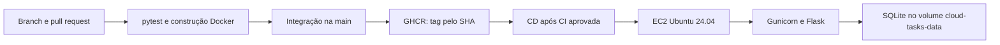

# Integração e implantação contínuas de uma API conteinerizada em Amazon EC2

**Rafael Bitu Castro de Abreu · Engenharia da Computação · RA22301190**

## Resumo

Este trabalho analisa uma esteira de integração e implantação contínuas para
uma API de tarefas, articulando GitHub Actions, Docker, GHCR e Amazon EC2.
A avaliação concentra-se na correspondência entre commit, imagem e instância,
no contrato HTTP e na persistência durante a substituição do contêiner. Nove
testes funcionais foram aprovados. A conservação de um registro após recriação
do contêiner demonstrou a separação entre os ciclos de vida do processo e dos
dados. Os resultados se restringem à configuração de instância única observada;
não permitem inferir desempenho sob carga ou tolerância à perda do host.

**Palavras-chave:** integração contínua; implantação contínua; contêineres;
computação em nuvem; persistência.

## 1. Introdução

Uma aplicação validada localmente ainda depende de construção, distribuição e
configuração para operar remotamente. Procedimentos manuais dificultam a
reprodução desse ambiente e a identificação da revisão em execução.

O problema investigado é como estabelecer uma cadeia rastreável entre integração
de código e execução em nuvem. A API Flask constitui o objeto de estudo, enquanto
a imagem identificada pelo SHA funciona como vínculo entre revisão e implantação.
A evolução funcional compreende a exclusão de tarefas e a identificação de versão.

## 2. Arquitetura e decisões de projeto

Flask concentra o contrato HTTP; Gunicorn executa dois workers. SQLite reduz o
número de serviços necessários e mantém o banco em um arquivo. A escolha
simplifica a análise do pipeline, mas vincula os dados ao host e não contempla
replicação. O Dockerfile utiliza Python 3.12 e executa o processo como `appuser`.

A porta 80 da EC2 é encaminhada à porta 8000 do contêiner. O diretório `/data`
utiliza um volume Docker, cujo ciclo de vida é independente do contêiner,
conforme a [documentação de volumes](https://docs.docker.com/engine/storage/volumes/).
Essa separação fundamenta o teste de persistência.

No PR, o pipeline executa testes e build sem publicar a imagem. No push para
`main`, publica `ghcr.io/bingxyi/cloud-pipeline-aws:<SHA>`. O CD utiliza o SHA da
CI bem-sucedida para selecionar a imagem. A organização por eventos e jobs segue
o modelo do [GitHub Actions](https://docs.github.com/en/actions/get-started/understand-github-actions).

## 3. Método

A avaliação abrangeu contrato funcional, execução dos workflows e estado remoto.
Os nove testes pytest utilizam bancos temporários. DELETE foi verificado para
recurso existente, com HTTP 204 sem corpo, e inexistente, com HTTP 404 em JSON.
O recurso `/version` foi comparado ao contrato `cloud-tasks-api`, versão `1.1.0`.

Os workflows foram inspecionados quanto ao evento de origem, ao resultado das
etapas e à ausência de publicação no PR. No ambiente remoto, compararam-se o
SHA da CI, o SHA do CD e a tag configurada no contêiner.

O experimento de persistência seguiu cinco passos: criar uma tarefa, registrar
o ID do contêiner, executar o deploy com a mesma imagem, obter o novo ID e
consultar novamente a tarefa. A diferença entre os IDs caracteriza a recriação,
e a conservação do registro verifica o armazenamento independente do processo.

## 4. Resultados

| Observação | Resultado | Fonte |
|---|---|---|
| Suíte funcional | Nove testes aprovados | [testes.txt](evidencias/testes.txt) |
| CI de PR | Testes e build aprovados; publicação ignorada | [github.json](evidencias/github.json) |
| Revisão implantada | SHA de CI/CD coincide com a tag em execução | [container.json](evidencias/container.json) |
| Saúde e versão | HTTP 200, status ok e versão 1.1.0 | [http.json](evidencias/http.json) |
| Exclusão remota | Respostas 204 e 404 em exclusões sucessivas | [evidencia-ec2.json](evidencia-ec2.json) |
| Persistência | Tarefa ID 1 conservada entre contêineres distintos | [evidencia-ec2.json](evidencia-ec2.json) |
| Registry | Manifest consultado sem credenciais de registry | [ghcr-manifest.json](evidencias/ghcr-manifest.json) |

A evolução funcional foi integrada pelo [PR #1](https://github.com/bingxyi/cloud-pipeline-aws/pull/1),
no merge `fedf0295356db273686130be3bdf76c3c5d5d87e`. A segunda coleta inspecionou
`57e2869681c5844205272fc67c3733817f5cd390`. Esses identificadores caracterizam
amostras históricas, não a revisão permanentemente mais recente do serviço.

A infraestrutura observada consiste em EC2 `t3.micro`, Ubuntu 24.04, Docker
29.1.3 e disco EBS gp3 de 8 GiB criptografado. IMDSv2 é obrigatório. O Security
Group permite HTTP público e limita SSH administrativo a IPv4 `/32`. O runner
recebe uma regra temporária também `/32`, revogada ao final do CD. Porta e
origem são os parâmetros de controle previstos no [modelo de regras da AWS](https://docs.aws.amazon.com/vpc/latest/userguide/security-group-rules.html).

O Cost Explorer retornou US$ 0,0408888848 em 15/11/2026 e US$ 0,047590091 em
16/11/2026: US$ 0,0884789758 estimados. Os valores referem-se à conta inteira e
estão sujeitos à consolidação. Não constituem atribuição exclusiva ao projeto
nem custo final de execução.

## 5. Discussão e limitações

A identificação por SHA permite rastrear a revisão, mas a tag não é uma garantia
de imutabilidade do registry. O deploy utiliza a tag, sem fixar o digest no pull;
o registro do digest serve como evidência da imagem observada.

O endpoint `/health` confirma uma consulta SQLite simples. Não demonstra
integridade completa dos dados ou capacidade de escrita sob carga. Os testes
funcionais também não substituem avaliações de concorrência e recuperação.

O volume protege contra a substituição do contêiner, mas não contra exclusão do
disco ou perda do host. Não há backup automático, replicação ou restauração
validada em outra instância. A substituição do contêiner introduz uma janela de
indisponibilidade e não inclui rollback automático.

Uma interrupção forçada do job ou a expiração das credenciais pode impedir a
revogação da regra SSH temporária. A inspeção posterior do Security Group
continua necessária. A API não implementa autenticação ou TLS, e a arquitetura
não deve ser interpretada como um ambiente de produção com dados sensíveis.

## 6. Considerações finais

O estudo demonstrou uma cadeia automatizada entre validação, distribuição e
implantação, com correspondência de revisão e conservação dos dados após
recriação do contêiner. A extensão do cenário pode incluir autenticação, TLS,
backup com restauração testada, menor interrupção no deploy e testes de carga.

O [protocolo de validação](VALIDACAO.md) detalha as fontes de observação. A
[documentação operacional](OPERACAO.md) descreve os limites do ciclo de vida.
