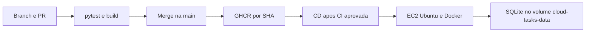

# Relatório de entrega — Cloud Tasks API

## Identificação e resultado

Responsável: Rafael Bitu Castro de Abreu, RA22301190. Projeto individual. Repositório: [bingxyi/cloud-pipeline-aws](https://github.com/bingxyi/cloud-pipeline-aws).

A implementação foi mesclada por [PR #1](https://github.com/bingxyi/cloud-pipeline-aws/pull/1) no commit `fedf0295356db273686130be3bdf76c3c5d5d87e`. A [CI do PR](https://github.com/bingxyi/cloud-pipeline-aws/actions/runs/43886754600), a [CI da main](https://github.com/bingxyi/cloud-pipeline-aws/actions/runs/43887501389) e o [CD](https://github.com/bingxyi/cloud-pipeline-aws/actions/runs/43887665966) foram aprovados. O CD implantou a imagem GHCR correspondente ao mesmo SHA.

## Implementação

- Flask/SQLite com GET `/health`, `/version`, `/tasks`; POST `/tasks`; PATCH e DELETE `/tasks/<id>`.
- DELETE retorna 204 vazio quando exclui e 404 JSON quando a tarefa não existe. `/version` identifica `cloud-tasks-api` versão `1.1.0`.
- Nove testes cobrem API, versão e persistência com recriação da aplicação usando o mesmo banco. A CI executa testes e build; a publicação de imagem ocorre na main, e o CD aguarda CI aprovada.
- GitHub `production` e secrets/variables requeridos foram configurados de forma segura. Credenciais não estão neste repositório.

## Infraestrutura e verificação remota

Conta AWS `109347287884`, região `us-east-1`. EC2 Ubuntu 24.04 `i-0c6f23086bc98c45e`, tipo `t3.micro`, IP `54.198.190.67`, Security Group `sg-09352ffbaa35709b2`. Cloud-init concluiu e Docker 29.1.3 foi confirmado via SSH.

Verificações após o deploy: `/health` respondeu status `ok`; `/version` respondeu `cloud-tasks-api` / `1.1.0`; DELETE respondeu 204 e, repetido para o mesmo ID, 404. A tarefa ID 1, título `Evidencia persistencia 20261116-113828`, permaneceu disponível após substituir o contêiner com `scripts/deploy.sh` usando a mesma imagem e volume `cloud-tasks-data`. IDs dos contêineres antes/depois, imagem e respostas estão em [evidencia-ec2.json](evidencia-ec2.json).

A imagem implantada foi `ghcr.io/bingxyi/cloud-pipeline-aws:fedf0295356db273686130be3bdf76c3c5d5d87e`, digest `sha256:ffc8f538af5aded1bafa37990154782112803de8faf162a8a3e0615d1fb6af7e`.

Ao final da verificação, as regras do Security Group eram SSH 22 de `189.6.11.151/32` e HTTP 80 de `0.0.0.0/0`; a regra temporária do runner foi removida. A instância permanece ligada para demonstração. Custos não foram inspecionados e a limpeza após a apresentação está pendente.

## Histórico e pendências

Uma tentativa inicial de SSH pelo ambiente Codex não conseguiu ler a chave local. Depois, a conexão foi confirmada pelo usuário via SSH; não é uma falha atual do host. O manifest da imagem base foi consultado anonimamente na EC2 com configuração Docker vazia antes do deploy.

- [ ] Inspecionar e registrar custos AWS.
- [ ] Realizar apresentação e manter evidências da entrega.
- [ ] Encerrar a EC2 após a demonstração e verificar volumes e IPs restantes.
