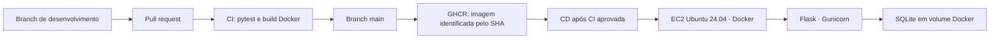

# Cloud Tasks API: arquitetura, integração contínua e implantação

**Autor:** Rafael Bitu Castro de Abreu · **Curso:** Engenharia da Computação · **Matrícula:** RA22301190

## Resumo

Este trabalho apresenta a implementação e a operação de uma API de gerenciamento de tarefas em nuvem. A aplicação utiliza Flask e SQLite, é empacotada em contêiner Docker e implantada em uma instância Amazon EC2. A integração contínua executa testes e build; após a integração da alteração à branch principal, a imagem identificada pelo SHA é publicada no GitHub Container Registry (GHCR), e o fluxo de entrega contínua a implanta na instância. Os resultados observados incluem nove testes aprovados, verificação remota das rotas de saúde, versão e exclusão, e preservação de uma tarefa após a recriação do contêiner com o volume de dados mantido. A avaliação também descreve o controle de acesso de rede e delimita o alcance da estimativa de custos disponível.

**Palavras-chave:** computação em nuvem; integração contínua; entrega contínua; contêineres; persistência.

## 1. Contexto e objetivo

O objetivo técnico é demonstrar um ciclo rastreável entre alteração de código, testes automatizados, publicação de imagem e implantação em nuvem. A API expõe operações de criação, consulta, atualização e remoção de tarefas. A alteração funcional avaliada adiciona a exclusão de tarefas e a rota de identificação de versão, preservando a arquitetura Flask/SQLite da aplicação de base.

## 2. Arquitetura

A instância observada foi uma `t3.micro` em `us-east-1`, executando Ubuntu 24.04 e Docker 29.1.3. A aplicação grava em `/data/tasks.db`, montado no volume `cloud-tasks-data`. A imagem implantada no snapshot auditado foi `ghcr.io/bingxyi/cloud-pipeline-aws:57e2869681c5844205272fc67c3733817f5cd390`. Esse SHA corresponde ao snapshot de documentação e operação auditado; a funcionalidade inicial foi integrada anteriormente pelo PR #1 no merge commit `fedf0295356db273686130be3bdf76c3c5d5d87e`, e o PR #3 atualizou a documentação.

## 3. Implementação e método de validação

A implementação expõe GET `/health`, `/version` e `/tasks`, POST `/tasks`, além de PATCH e DELETE em `/tasks/<id>`. A rota `/version` retorna `cloud-tasks-api` e `1.1.0`. DELETE retorna 204 sem corpo quando remove uma tarefa e 404 com objeto JSON para um identificador inexistente.

A validação combinou nove testes automatizados, build e smoke test do contêiner, inspeção dos resultados dos workflows e consultas HTTP à instância. A suíte verifica operações da API, validação de entrada, contrato de versão, códigos de resposta do DELETE e persistência entre instâncias da aplicação que compartilham o mesmo arquivo SQLite. A persistência no contêiner remoto foi examinada separadamente: uma tarefa foi consultada antes e depois da substituição do contêiner pelo script de deploy, mantendo a imagem e o volume. O registro de execução está em [evidencia-ec2.json](evidencia-ec2.json).

Os workflows observados incluem uma CI de PR aprovada ([run 43886754600](https://github.com/bingxyi/cloud-pipeline-aws/actions/runs/43886754600)), uma CI da branch principal para o snapshot auditado ([run 43889934062](https://github.com/bingxyi/cloud-pipeline-aws/actions/runs/43889934062)) e um CD aprovado ([run 43890085299](https://github.com/bingxyi/cloud-pipeline-aws/actions/runs/43890085299)). O PR #1 introduziu a funcionalidade; o PR #3 atualizou a documentação. O fluxo de PR executa testes e build, enquanto a publicação no GHCR ocorre na branch principal. O CD implanta a imagem vinculada ao SHA da execução aprovada.

## 4. Resultados

Na instância `54.198.190.67`, GET `/health` retornou `{"status":"ok"}` e GET `/version` identificou o serviço como `cloud-tasks-api`, versão `1.1.0`. A validação remota do DELETE produziu 204 na primeira solicitação para a tarefa existente e 404 na repetição para o identificador já removido.

A prova de persistência utilizou a tarefa de ID 1, intitulada `Evidencia persistencia 20261116-113828`. Os identificadores dos contêineres anterior e posterior à implantação são diferentes; a tarefa permaneceu disponível após a substituição, consistente com a montagem do banco no volume Docker. A evidência inclui os identificadores dos contêineres, referência de imagem e respostas observadas.

A imagem do snapshot auditado possui a referência `ghcr.io/bingxyi/cloud-pipeline-aws:57e2869681c5844205272fc67c3733817f5cd390`. O digest registrado é `sha256:ffc8f538af5aded1bafa37990154782112803de8faf162a8a3e0615d1fb6af7e`.

## 5. Segurança e limites

O Security Group observado permite HTTP na porta 80 a partir de qualquer origem e restringe SSH na porta 22 ao endereço administrativo `189.6.11.151/32`. A regra temporária de SSH utilizada pelo runner foi removida ao fim do workflow de CD. Os secrets e variables do ambiente `production` não são incluídos nos arquivos do projeto. A instância usa Ubuntu 24.04; o volume EBS observado é gp3 de 8 GiB, criptografado, com IMDSv2 obrigatório.

A persistência demonstrada cobre a recriação do contêiner enquanto o volume é preservado. Ela não demonstra recuperação após perda ou exclusão do volume, nem substitui uma estratégia de backup. O volume está configurado para exclusão junto com o encerramento da instância. Não foram medidos desempenho, latência, carga concorrente ou disponibilidade prolongada; portanto, os resultados não sustentam conclusões sobre esses atributos.

## 6. Custos observados

A consulta ao Cost Explorer registrou `UnblendedCost` estimado de US$ 0,0408888848 em 15/11/2026 e US$ 0,047590091 em 16/11/2026, total de US$ 0,0884789758. Trata-se do total da conta AWS, sem atribuição exclusiva a este projeto, e os dois valores estavam marcados como estimados no momento da coleta. Não correspondem necessariamente à fatura final. A instância permaneceu ativa para a apresentação; não se afirma que a limpeza dos recursos foi executada.

## Referências e evidências

- [Repositório e PR #1](https://github.com/bingxyi/cloud-pipeline-aws/pull/1)
- [PR #3 — atualização documental](https://github.com/bingxyi/cloud-pipeline-aws/pull/3)
- [Evidência da API e persistência EC2](evidencia-ec2.json)
- [Dados de validação da infraestrutura, workflows e custos](evidencias/)
- [Apresentação em slides](apresentacao.html)
